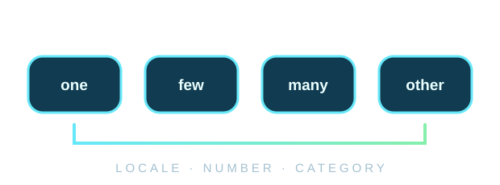

<p align="center">
  
  <br/>
  <br/>   
  <br/>
</p>

## 🧭 Overview

Locale Plural Rules Lab is a browser-based explorer for the built-in `Intl.PluralRules` API. Compare cardinal and ordinal categories, test custom numbers, and inspect how locale rules differ.

## ✨ Features

- 🌍 Try any locale tag supported by the browser's internationalization data.
- 🔢 Switch between cardinal and ordinal selection.
- 🧪 Test custom numeric values and a useful sample range.
- 🏷️ See the locale's resolved plural categories.
- 🔒 All processing stays in the browser; no external libraries.

## 🎬 Demo

Run locally, enter a locale such as `en`, `ar`, or `ru`, and compare the category table. Results depend on the browser's ICU/CLDR data; no hosted demo is claimed.

## 🚀 Quick Start

Requires Node.js 18 or newer.

```bash
npm start
```

Open http://localhost:4173.

## 🧰 Tech Stack

- 🟢 Node.js built-in HTTP server
- 🌐 HTML, CSS, browser JavaScript, and `Intl.PluralRules`
- 📦 No third-party runtime dependencies

## 🗂️ Folder Structure

```text
locale-plural-rules-lab/
├── assets/mark.svg
├── app.js
├── index.html
├── server.js
├── package.json
├── README.md
├── LICENSE
└── .gitignore
```

## 🛣️ Roadmap

- [ ] Add sample phrase templates for each category.
- [ ] Compare multiple locales side by side.
- [ ] Add a small ICU MessageFormat preview.

## 🤝 Contributing

Contributions should include locale examples and explain the browser support assumptions. Test with `npm start` and at least two locales.

## 📄 License

MIT licensed. See [LICENSE](LICENSE).

<p align="center"></p>
